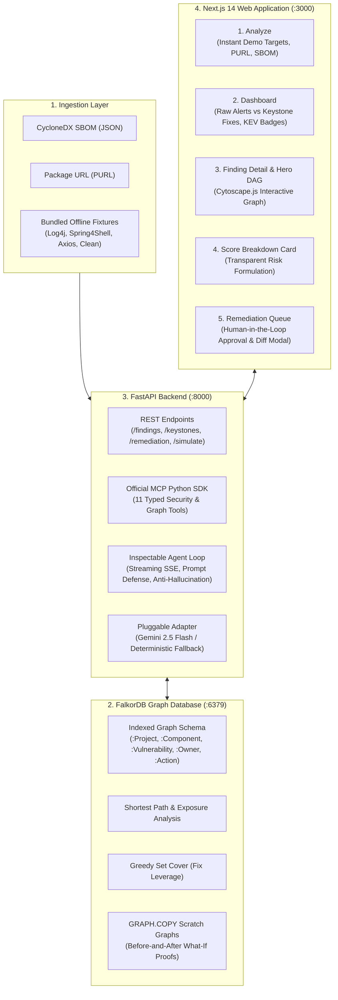

# KEYSTONE: Graph-Native Software Vulnerability Remediation Agent

[](https://wemakedevs.org)
[](https://falkordb.com)
[](https://fastapi.tiangolo.com)
[](https://nextjs.org)
[](https://js.cytoscape.org)
[](https://modelcontextprotocol.io)

> **Eliminating Software Supply Chain Alert Fatigue**: Turning hundreds of scattered vulnerability alerts into a short, proven list of direct upgrades, verified with native before-and-after what-if simulation proofs on FalkorDB before drafting human-approved fixes.

---

## 🎯 Executive Summary & Problem Statement

Modern enterprise software depends on deep, nested dependency graphs. A typical service easily pulls in hundreds of transitive packages. When a critical zero-day like **Log4Shell** or **Spring4Shell** strikes:

1. **Alert Fatigue**: Security scanners produce floods of duplicate alerts for the exact same transitive flaw across different internal services.
2. **False Urgency & Blind Spots**: Flat CVSS scores ignore whether a library is 1 hop away or buried 6 levels deep.
3. **Fear of Regressions**: Engineering teams hesitate to upgrade parent dependencies without concrete proof that an upgrade resolves the target CVE without introducing breaking changes or newer vulnerabilities.

**KEYSTONE** solves this natively at the graph layer using **FalkorDB**:
- **Graph Traversal & Shortest Path**: Traces exact dependency paths from root services down to vulnerable libraries (`shortestPath((p:Project)-[:DECLARES|DEPENDS_ON*]->(c:Component))`).
- **Keystone Bottlenecks**: Identifies shared parent libraries that unlock dozens of downstream fixes simultaneously.
- **Greedy Set Cover Optimization**: Computes the absolute minimum set of direct dependency upgrades required to eliminate the maximum number of transitive CVEs.
- **What-If Simulation Proofs (`GRAPH.COPY`)**: Clones the active workspace into an ephemeral scratch graph, simulates the version upgrade, evaluates regression invariants and net risk reduction, and drops the scratch graph—leaving production data 100% intact.
- **Strict Human-in-the-Loop Safety**: The AI agent operates through official MCP tools and can only transition fixes to `PROPOSED`. Patch drafting requires explicit human verification and approval.

---

## 🏛️ System Architecture



---

## ⚡ Quickstart (Under 5 Commands)

### Option A: Complete Docker Compose (Production Ready)

```bash
# 1. Clone repository
git clone https://github.com/your-username/keystone.git && cd keystone

# 2. Launch FalkorDB, Backend, and Frontend in persistent containers
docker compose up --build
```
- Open Frontend: [http://localhost:3000](http://localhost:3000)
- Open FastAPI Swagger Docs: [http://localhost:8000/docs](http://localhost:8000/docs)
- FalkorDB Graph Redis Endpoint: `localhost:6379`

---

### Option B: Local Development Setup

#### Step 1: Start FalkorDB
```bash
docker run -d --name falkordb -p 6379:6379 -v falkordb_data:/data falkordb/falkordb:v4.4.0
```

#### Step 2: Start Backend
```bash
# In project root
python -m venv .venv
source .venv/bin/activate  # On Windows: .venv\Scripts\activate
pip install -r backend/requirements.txt
uvicorn backend.app.main:app --host 0.0.0.0 --port 8000 --reload
```

#### Step 3: Start Frontend
```bash
cd frontend
npm install
npm run dev
```

---

## 🧪 Verification & Test Suite

The entire backend, graph query engine, MCP tool registry, and agent loop are validated by a 40-test automated test suite:

```bash
# Run complete test suite (unit, integration, and golden evals)
pytest backend/tests evals/test_evals.py -v
```

### Test Coverage Highlights:
- **`test_falkordb_down_loud_failure`**: Verifies that the system throws a loud HTTP 503 error immediately when FalkorDB is unreachable (no silent in-memory fallbacks).
- **`test_falkordb_live_connection`**: Verifies connectivity, index creation, and live OpenCypher execution.
- **`test_explain_finding_shortest_path`**: Verifies that FalkorDB calculates graph shortest path depths and evidence nodes.
- **`test_whatif_simulator_log4j_patch`**: Verifies that `GRAPH.COPY` scratch graphs correctly simulate upgrading `log4j-core` to `2.17.1`, proving that `CVE-2021-44228` and `CVE-2021-45046` are resolved with 0 regressions.
- **`evals/test_evals.py`**: 20 comprehensive golden evaluation scenarios testing prompt-injection resistance, ungrounded claim rejection, and unknown CVE handling.

---

## 🔍 Non-Negotiable Technical Guarantees

| Requirement | Implementation Verification |
| :--- | :--- |
| **FalkorDB Does the Graph Work** | All pathfinding, blast-radius calculations, keystone rankings, and set cover logic run as parameterised OpenCypher queries on FalkorDB. **Zero NetworkX or in-memory graph libraries**. |
| **What-If Simulation Proofs** | Ephemeral scratch graphs created with native `GRAPH.COPY <workspace_id> <scratch_id>`. Edge mutations, re-evaluations, and regression checks execute in isolation. Original graph is 100% unaltered. |
| **Loud Failure on Database Down** | `FalkorDBManager` enforces ping connectivity. If the server is offline or fails to respond, it raises `HTTPException(status_code=503)`. |
| **Model Safety & Human-in-the-Loop** | The agent and tools can only create actions in `PROPOSED` status. Transitioning to `APPROVED` and finalizing patch drafts requires explicit human confirmation via the UI. |
| **Offline Resilience** | 4 static bundled fixtures (`log4j_cyclonedx.json`, `spring4shell_cyclonedx.json`, `axios_cyclonedx.json`, `clean_project_cyclonedx.json`) ensure all demos and tests execute without external internet access. |

---

## 📊 Documentation Index

- **[FalkorDB Cypher Queries Reference](docs/QUERIES.md)**: Full parameterised query catalog covering ingestion, shortest path, blast radius, keystone bottlenecks, set cover, and simulation.
- **[Architectural Decision Records](docs/DECISIONS.md)**: Key technical choices, tradeoffs, and rationale.
- **[AI Usage & Human Oversight](docs/AI_USAGE.md)**: Disclosure of AI assistant usage, prompt defense architecture, and deterministic auto-triage fallback.

---

## 🏆 WeMakeDevs x FalkorDB Graph Hacks Hackathon

- **Track**: Track 01: "Agents That Act on Connected Data"
- **Project Name**: KEYSTONE
- **License**: Apache-2.0
